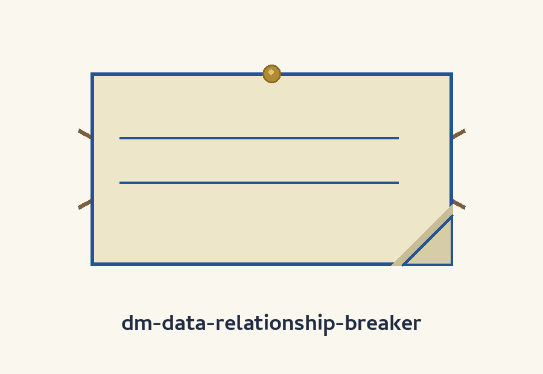
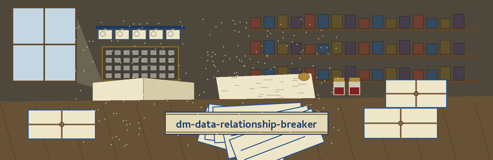

# dm-data-relationship-breaker

Catalogue entry, author first: the name above is set in Cambay in post office blue, with a small date stamp picture at the left of this title block and the citation slip kept small beside the headings that follow.

# dm-data-relationship-breaker
Identifies and breaks relationships between data points to prevent re-identification. For example, it could randomly reassign addresses to individuals within a city to eliminate direct linkages. - Focused on Tools designed to generate or mask sensitive data with realistic-looking but meaningless values

## Install
`git clone https://github.com/ShadowStrikeHQ/dm-data-relationship-breaker`

> Citation slip, pinned at the corner: the README install line names a predecessor organisation. The slip is transcribed as printed and left alone; the corrected address lives on the website, labelled as a correction there.

## Usage
`./dm-data-relationship-breaker [params]`

> Citation slip, pinned at the corner: the live README carries no behaviour section at all, so no exit code and no write order exist in either record. None is invented here.

## Parameters
- `-h`: Show help message and exit
- `--city`: The city to reassign addresses within.
- `--num_records`: The number of records to generate and reassign.
- `--output_file`: No description provided
- `--seed`: Optional seed for Faker

> Citation slip, pinned at the corner: the example works inside one city only.

> Citation slip, pinned at the corner: the output file control is printed with no description in the source, and it is carried exactly so.

> Citation slip, pinned at the corner: no default is printed for city or record count.

## License
Copyright (c) ShadowStrikeHQ

## Filed at the sorting table

The main button of this re-skin reads Break the Linkages. Its city field label reads City. Its count field label reads Records to Generate and Reassign. Its example heading reads Same City, New Pairings. It ends with the chosen slip resting on the finished page, bundles retied, volumes shut with their ribbons inside, the press at rest, and the edition complete.
